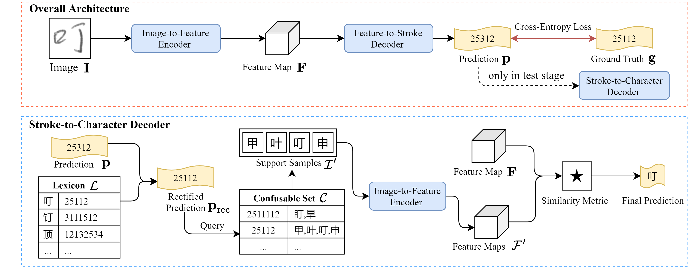

# CCR-HandWriting

## Stroke-Level Decomposition

This project implements the approach from the IJCAI 2021 paper:

**"Zero-Shot Chinese Character Recognition with Stroke-Level Decomposition"**

Original paper implementation: [FudanVI/FudanOCR](https://github.com/FudanVI/FudanOCR/tree/main/stroke-level-decomposition/document)



## Project Structure

This repository contains the implementation and supporting files for training and testing Chinese handwritten character recognition using stroke-level decomposition.

## Dependencies

Create a Python environment and install the required libraries:

```bash
pip install -r requirement.txt
```

## Experiment

Before running the experiment:

1. Modify the configuration parameters in `config.py`.
2. Prepare the required dataset and model files.
3. Execute the training script:

```bash
python train.py
```

For inference, use:

```bash
python inference.py
```

## Notes

Dataset files, trained model checkpoints, and training history are excluded from this repository due to their large file sizes. They should be stored separately.

## Reference

Zero-Shot Chinese Character Recognition with Stroke-Level Decomposition, IJCAI 2021.

